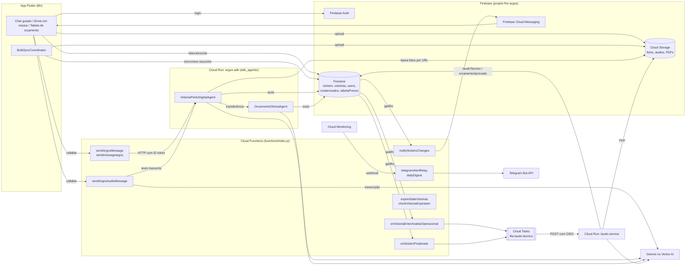
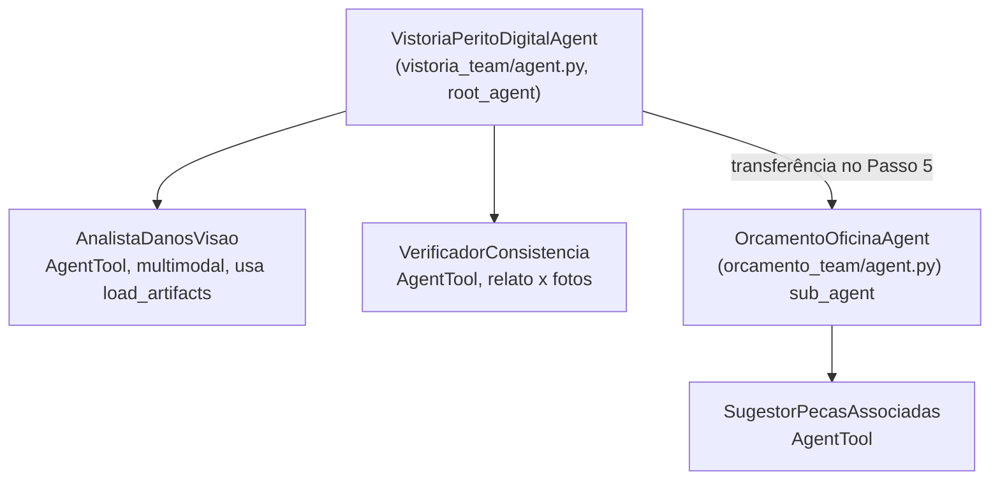
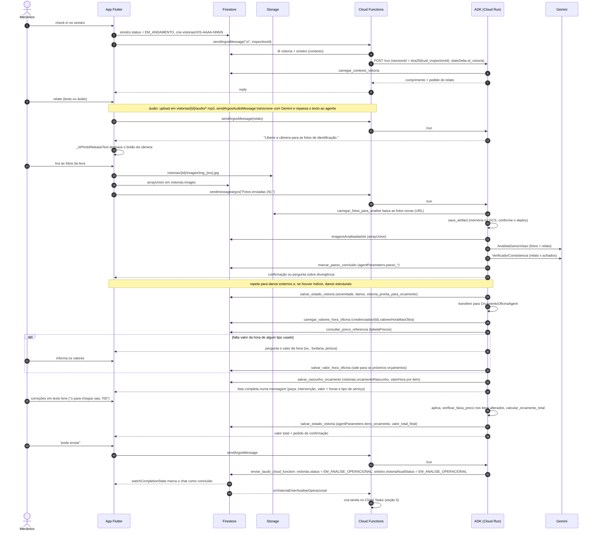
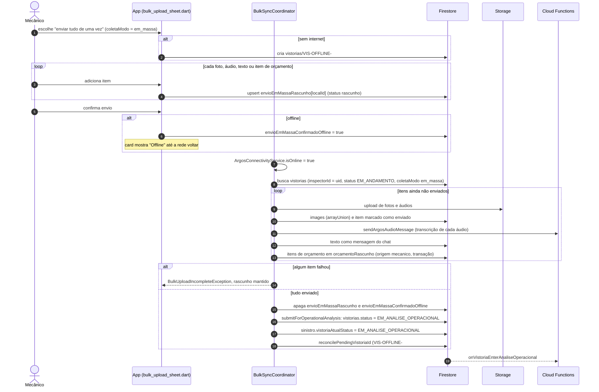

# Arquitetura do Argos

Este documento descreve como as partes do Argos que vivem neste repositório se conectam: o app Flutter, o backend no Firebase, o agente conversacional (Google ADK) e o gerador de PDFs. Tudo aqui foi conferido no código; quando algo depende de configuração externa ao repositório (regras do Firestore, painel web), isso está indicado.

Comandos de implantação estão em [DEPLOY.md](DEPLOY.md).

## Sumário

1. [Visão geral](#1-visão-geral)
2. [Diagrama de componentes](#2-diagrama-de-componentes)
3. [Fluxo passo a passo (chat guiado)](#3-fluxo-passo-a-passo-chat-guiado)
4. [Fluxo "enviar tudo de uma vez" (em massa)](#4-fluxo-enviar-tudo-de-uma-vez-em-massa)
5. [Geração dos PDFs](#5-geração-dos-pdfs)
6. [Modelo de dados no Firestore](#6-modelo-de-dados-no-firestore)
7. [Regra de cálculo do orçamento](#7-regra-de-cálculo-do-orçamento)
8. [Estratégia offline](#8-estratégia-offline)
9. [Notificações e monitoramento](#9-notificações-e-monitoramento)
10. [Limitações conhecidas](#10-limitações-conhecidas)

---

## 1. Visão geral

O mecânico de uma oficina credenciada recebe um sinistro no app, faz o check-in e coleta as evidências (fotos, áudios, relato e orçamento) de duas formas:

- **Passo a passo:** um chat com o agente de IA, que pede cada leva de fotos, analisa as imagens, confronta com o relato e conduz o orçamento.
- **Enviar tudo de uma vez:** o mecânico junta fotos, áudios, texto e itens de orçamento num rascunho, sem conversa, e envia o pacote. Esse modo funciona offline e sincroniza quando a rede volta.

Quando a vistoria entra em `EM_ANALISE_OPERACIONAL`, uma Cloud Function enfileira a geração do **laudo técnico em PDF** no `laudo-service` (Cloud Run). Quando o analista da seguradora finaliza o sinistro (`status = FINALIZADO`), o mesmo serviço gera o **PDF do orçamento aprovado**.

| Componente | Pasta | Tecnologia | Papel |
|---|---|---|---|
| App mobile | `lib/` | Flutter (Android) | check-in, coleta guiada ou em massa, tabela de orçamento, histórico, métricas |
| Cloud Functions | `functions/index.js` | Node 22, Firebase Functions v2 | ponte app ↔ agente, transcrição de áudio, notificações push, gatilhos de PDF, expiração de vistorias, monitoramento no Telegram |
| Agente conversacional | `adk_agents/` | Python, Google ADK 2.8, Gemini 2.5 Flash (Vertex AI) | conduz a vistoria (`vistoria_team`) e o orçamento (`orcamento_team`) |
| Gerador de PDF | `services/laudo-service/` | Node 22, Express, Puppeteer, Gemini | laudo técnico e orçamento aprovado em PDF |
| Painel web | repositório separado (`web-argos`) | Next.js | seguradora despacha, revisa e aprova (fora deste repositório) |

Projeto Firebase/GCP: `fho-argos`, região `us-central1`.

## 2. Diagrama de componentes



Pontos importantes:

- O app **não fala direto com o agente**. Toda mensagem passa pelas callables `sendArgosMessage` (conversa), `sendmessageargos` (avisos de sistema do app, como `Fotos enviadas (N).` e `enviei o orçamento`) e `sendArgosAudioMessage` (áudio). As callables chamam o Cloud Run do ADK com ID token OIDC, porque o serviço sobe com `--no-allow-unauthenticated`.
- O ID da sessão do agente é determinístico: `sha256(uid_inspectionId)` (32 caracteres). Se a sessão não existir mais no ADK (cold start, novo deploy, reciclagem de instância), `functions/index.js` recria a sessão já com as últimas 40 mensagens de `vistorias/{id}.chatmessages`, só texto.
- O agente lê e grava no Firestore diretamente pelas próprias tools (`adk_agents/common/firestore_tools.py`, `orcamento_team/tools/`). As fotos não chegam ao agente pelo app; a tool `carregar_fotos_para_analise` baixa cada `images[].url` por HTTP e salva como artefato do ADK.
- O `laudo-service` não é chamado diretamente: as Functions criam uma tarefa no Cloud Tasks com nome determinístico (`laudo-{sinistroId}-{vistoriaId}` ou `orcamento-...`), o que evita duplicidade, e o Cloud Tasks faz as novas tentativas se o Cloud Run responder 5xx.

### Árvore de agentes (ADK)



O modelo vem da variável `ARGOS_MODEL` (padrão `gemini-3.8-flash`, ver `adk_agents/common/config.py`); o analista de fotos pode usar outro via `ARGOS_MODEL_VISAO`. Tools da vistoria: `carregar_contexto_vistoria`, `salvar_estado_vistoria`, `marcar_passo_concluido`, `marcar_fotos_analisadas`, `consultar_manual_sinistros`, `carregar_fotos_para_analise`. Tools do orçamento: `carregar_contexto_vistoria`, `salvar_estado_vistoria`, `salvar_rascunho_orcamento`, `consultar_preco_referencia`, `verificar_faixa_preco`, `calcular_orcamento_total`, `carregar_valores_hora_oficina`, `salvar_valor_hora_oficina`, `enviar_laudo_cloud_function`.

No chat guiado, o orçamento é montado no próprio chat: o agente manda a lista completa numa mensagem, o mecânico corrige em texto livre e o agente pede confirmação antes de enviar. A mão de obra usa o valor da hora da oficina por tipo de serviço (`credenciados/{id}.valoresHoraMaoObra`); se faltar algum, o agente pergunta e salva no cadastro. A tabela nativa (`OrcamentoTablePage`) é usada no envio em massa.

## 3. Fluxo passo a passo (chat guiado)

As "travas de estado" da câmera e da tabela de orçamento ficam **em memória no app**: não há campo no Firestore. O app destrava quando a resposta do agente contém a frase-gatilho (`_isPhotoReleaseText` e `_isOrcamentoReleaseText` em `lib/features/ai_chat/ai_chat_page.dart`). Ao reabrir o chat, o estado da câmera é recalculado a partir do histórico.



Observações:

- Apesar do nome, `enviar_laudo_cloud_function` (`adk_agents/orcamento_team/tools/laudo_tool.py`) não chama nenhuma Cloud Function: ela grava o status no Firestore, e o gatilho `onVistoriaEnterAnaliseOperacional` faz o resto.
- No modo guiado, quem grava `EM_ANALISE_OPERACIONAL` é o agente. O app só observa o documento da vistoria.
- O agente só chama `enviar_laudo_cloud_function` depois de uma confirmação explícita do mecânico (Passo 6 do prompt do orçamento). Se o mecânico quiser corrigir, o agente aplica a mudança, recalcula e pede confirmação de novo.
- Retificação (vistoria rejeitada pela seguradora) sempre usa o modo guiado, com `modo: 'retificacao'` na callable. A câmera já começa destravada e o fluxo exige internet.
- Fotos no modo guiado exigem conexão. Sem rede, o app oferece mudar para o modo em massa.

## 4. Fluxo "enviar tudo de uma vez" (em massa)

O rascunho fica no próprio documento da vistoria (`vistorias/{id}.envioEmMassaRascunho`), um mapa `localId → item`, com `tipo` em `foto | audio | texto | orcamento` e `status` em `rascunho | enviado`. Fotos e áudios ficam também como arquivos locais (`argos_bulk_pendente/`). Cada alteração é gravada na hora, então o rascunho sobrevive ao fechamento do app e, offline, fica na fila de escrita do Firestore.



Observações:

- Limites: até 10 fotos (`kBulkMaxPhotos`) e 10 áudios (`kBulkMaxAudios`) por pacote.
- O ID definitivo (`VIS-AAAA-NNNN`) vem do contador `counters/vistorias_{ano}`, que só pode ser incrementado online. A reconciliação copia o documento provisório para o ID real, atualiza `sinistro.vistoriaAtualId` e apaga o provisório num único batch.
- Os cards mostram "Sincronizando..." enquanto o ID da vistoria está em `BulkSyncCoordinator.syncingVistoriaIds`.
- Nesse fluxo o agente não participa da coleta. O laudo usa as fotos, as transcrições e os itens com `origem: 'mecanico'` em `orcamentoRascunho`.

## 5. Geração dos PDFs

```mermaid
sequenceDiagram
    autonumber
    participant FS as Firestore
    participant CF as Cloud Functions
    participant CT as Cloud Tasks (laudo-tecnico)
    participant LS as laudo-service
    participant G as Gemini
    participant ST as Storage

    FS-->>CF: sinistro.vistoriaAtualStatus muda para EM_ANALISE_OPERACIONAL
    CF->>CT: createTask laudo-{sinistroId}-{vistoriaId} (OIDC laudo-invoker)
    CT->>LS: POST /gerar-laudo {sinistroId, vistoriaId}
    LS->>FS: laudoTecnico.status = gerando
    LS->>FS: lê sinistro + vistoria (resolve VIS-OFFLINE já reconciliada)
    LS->>G: fotos + transcrição -> achados em JSON
    LS->>LS: Handlebars + Puppeteer -> PDF
    LS->>ST: vistorias/{vistoriaId}/vistorias/Laudo Técnico {vistoriaId}.pdf
    LS->>FS: laudoTecnico = {status: pronto, url, storagePath, classificacaoContran, achados, ...}
    Note over CT,LS: 500 = Cloud Tasks tenta de novo; 400 = erro do chamador, sem nova tentativa
    FS-->>CF: sinistro.status muda para FINALIZADO (painel web)
    CF->>CT: createTask orcamento-{sinistroId}-{vistoriaId}
    CT->>LS: POST /gerar-orcamento-aprovado
    LS->>ST: Orçamento Aprovado {vistoriaId}.pdf
    LS->>FS: orcamentoAprovado = {status: pronto, url, valorTotal, ...}
```

- As duas rotas são idempotentes: se o PDF daquela vistoria já está `pronto`, respondem `ja_existia` sem gerar de novo.
- Se `LAUDO_SERVICE_URL` ou `ORCAMENTO_SERVICE_URL` estiver vazia, a Function grava `status: "erro"` no campo correspondente em vez de falhar em silêncio.
- A URL gravada é uma URL de download do Firebase Storage com token (`firebaseStorageDownloadTokens`).

## 6. Modelo de dados no Firestore

Coleções de nível superior. Só os campos efetivamente usados pelo código deste repositório estão listados.

| Coleção / documento | Quem escreve | Campos principais |
|---|---|---|
| `sinistro/{id}` | painel web, app, agente, Functions, laudo-service | `protocol`, `status` (ex.: `EM_ANDAMENTO`, `FINALIZADO`), `priority`, `claimType`, `credenciadoId`, `clienteSnapshot`, `veiculoSnapshot`, `credenciadoSnapshot`, `seguradoraSnapshot`, `damageDescription`, `assignedToUid`/`assignedToName`/`assignedToEmail`, `checkInAt`, `vistoriaAtualId`, `vistoriaAtualStatus`, `vistoriaAtualTipo`, `vistoriaAtualOrigemId`, `retificacaoAtualId`, `ultimaVistoriaAt`, `precisaRetificacao`, `motivoRejeicao`, `ajustesNecessarios`, `activeViewers`/`activeViewersCount` |
| `sinistro/{id}.laudoTecnico` (mapa) | laudo-service | `status` (`gerando` \| `pronto` \| `erro`), `vistoriaId`, `vistoriaIdSolicitado`, `url`, `storagePath`, `classificacaoContran`, `achados`, `modelo`, `geradoEm`, `erro` |
| `sinistro/{id}.orcamentoAprovado` (mapa) | laudo-service | `status`, `vistoriaId`, `url`, `storagePath`, `valorTotal`, `erro` |
| `sinistro/{id}/viewers/{uid}` | app | presença de quem está com o sinistro aberto (`active`, `lastSeenAt`, `expiresAt`) |
| `vistorias/{VIS-AAAA-NNNN}` | app, agente, Functions | `idvistoria`, `sinistroId`, `status` (`EM_ANDAMENTO`, `EM_ANALISE_OPERACIONAL`, `FINALIZADA`, `REJEITADA`, `CANCELADA`, `EXPIRADA`, `ABANDONADA`), `tipoVistoria` (`ORIGINAL` \| `RETIFICACAO`), `coletaModo` (`guiado` \| `em_massa`), `credenciadoId`, `inspectorId`, `placa`, `veiculo`, `cliente`, `descricaoArtigos`, `images[]`, `audios[]`, `chatmessages[]`, `agentParameters`, `agentCurrentAgent`, `agentBusinessExpiresAt`, `imagensAnalisadasIds`, `submittedAt`, `vistoriaOrigemId`, `contextoVistoriaAnterior` |
| `vistorias/{id}.envioEmMassaRascunho` (mapa) | app | `localId → {tipo, status, localPath, ...}`; texto na chave `__texto__`; `envioEmMassaConfirmadoOffline` ao lado |
| `vistorias/{id}.orcamentoRascunho` (lista) | agente (`salvar_rascunho_orcamento`) e app (envio em massa) | `peca`, `tipoIntervencao`, `quantidade`, `valorPeca`, `tipoServico`, `horasMaoObra`, `valorHora`, `origem` (`vistoria` \| `sugestao_aceita` \| `mecanico`); itens do app trazem também `id` |
| `vistorias/{id}.orcamentoItensFinais` (lista) | app (tabela nativa; não usada no fluxo guiado atual) | `id`, `peca`, `tipoIntervencao` (`reparo` \| `substituicao`), `quantidade`, `valorPeca`, `tipoServico`, `horasMaoObra`, `valorHora` (congelado), `valorMaoObra`, `valorTotal`, `origem` |
| `vistorias/{id}/audios` | app, Functions | áudios e transcrições exibidos no histórico |
| `users/{email}` | app | `status` (`pendente` \| `ativo` \| `bloqueado`; novo cadastro entra `pendente` e só usa o app quando `ativo`), `cadastroCompleto`, `credenciadoId`, `credenciadoNome`, `uid`, `email`, `nome`/`displayName`, `cpf`, `photoURL`, `tipoAcesso` |
| `credenciados/{id}` | painel web e app | `name`, `funcionariosUids[]` (mecânicos da oficina), `valoresHoraMaoObra` (mapa por tipo de serviço: `funilaria`, `pintura`, `mecanica`, `eletrica`), `valoresHoraAtualizadoEm` |
| `tabelaPrecos/{categoria}/pecas/{peca}` | `adk_agents/scripts/seed_tabela_precos.py` | `peca`, `valorPeca`, `horasMaoObra`; categorias `popular_compacto`, `medio_suv_compacto`, `suv_grande_picape` |
| `userDevices/{uid}/tokens/{token}` | app | tokens FCM (`token`, `platform`, `permissionStatus`) |
| `counters/vistorias_{ano}` | app (transação) | `lastNumber` para gerar `VIS-AAAA-NNNN` |
| `_processedEvents/{eventId}` | Functions | `processedAt`, `expireAt` (24 h); evita push duplicado quando o Eventarc reentrega o evento |

Caminhos no Storage (bucket `fho-argos.firebasestorage.app`):

- Fotos: `vistorias/{vistoriaId}/images/img_{ms}.jpg`
- Áudios: `vistorias/{vistoriaId}/audio/{audioId}.mp3`
- PDFs: `vistorias/{vistoriaId}/vistorias/Laudo Técnico {vistoriaId}.pdf` e `.../Orçamento Aprovado {vistoriaId}.pdf`
- Foto de perfil: `users/{email}/profile_{ms}.jpg`

## 7. Regra de cálculo do orçamento

```
valor do item  = valorPeca × quantidade + horasMaoObra × valorHora
valor total    = soma dos itens
```

- **Tipo de serviço** de cada item: `funilaria` (padrão), `pintura`, `mecanica` ou `eletrica` (`lib/features/orcamento/orcamento_calculo.dart`).
- **Valor da hora** vem de `credenciados/{id}.valoresHoraMaoObra[tipoServico]`, configurado pela própria oficina. Se a oficina ainda não tem valores, o app pede ao abrir a tabela (envio em massa) e o agente pergunta no chat (fluxo guiado); nos dois casos o valor fica salvo na oficina. Um item com horas e sem valor da hora para o seu tipo bloqueia o envio.
- **Valor congelado no item:** ao salvar, o app e o agente gravam `valorHora` dentro de cada item. Mudar o valor da hora da oficina depois não altera orçamentos já enviados.
- **Itens antigos** sem `valorHora` usam 90,00 (`kValorHoraLegado` no app, `VALOR_HORA_LEGADO` no laudo-service, `_VALOR_HORA_LEGADO` no agente).
- **Preço de referência:** o app pré-preenche só campos vazios a partir de `tabelaPrecos`, com a categoria escolhida pelo modelo do veículo (padrão `popular_compacto`). O agente usa a mesma tabela em `consultar_preco_referencia` e, em `verificar_faixa_preco`, sinaliza valores mais de 20% **acima** da referência (valores abaixo não são sinalizados).
- O mesmo cálculo é feito em três lugares (app, agente em `calcular_orcamento_total`, laudo-service em `lib/data.js`). O laudo-service lê os itens nesta ordem: `orcamentoItensFinais` → `orcamentoRascunho` com `origem: 'mecanico'` → `agentParameters.itens_orcamento` (vistorias antigas).

## 8. Estratégia offline

- **Cache do Firestore:** o app usa a persistência offline padrão do SDK mobile (não há configuração explícita). Leituras críticas usam `GetOptions(source: Source.cache)` primeiro, e gravações offline não são aguardadas (`_writeNoWaitOffline`), para a interface não travar.
- **Não há banco local separado** (sem Hive, sqflite ou shared_preferences). A fila de envio é o próprio `envioEmMassaRascunho` no Firestore mais os arquivos em `argos_bulk_pendente/`.
- **Conectividade:** `ArgosConnectivityService` combina `connectivity_plus` com uma consulta DNS (timeout de 3 s) e expõe `isOnline`. A barra global mostra "VOCÊ ESTÁ OFFLINE" / "CONECTADO NOVAMENTE".
- **Vistoria criada offline** recebe ID provisório `VIS-OFFLINE-####` e é reconciliada depois (seção 4).
- **Bloqueios offline:** check-in desabilitado; fotos no modo guiado indisponíveis (o app oferece mudar para o envio em massa); retificação bloqueada com tela própria, porque não tem modo alternativo; logout avisa se há envio em massa pendente.
- **Sincronização:** `BulkSyncCoordinator` (singleton criado no `main()`) reage à volta da rede e envia tudo o que estiver pendente do usuário.

## 9. Notificações e monitoramento

- **Push (FCM):** `notifySinistroChanges` reage a escritas em `sinistro/{id}`, monta a mensagem (novo sinistro, vistoria rejeitada, aprovada, expirada, sincronizada etc.) e envia para os tokens de `userDevices/{uid}/tokens` de todos os `funcionariosUids` da oficina. Usa `_processedEvents` para não duplicar.
- **Expiração:** `expireStaleVistorias` (a cada 12 h) e `checkVistoriaExpiration` (callable, chamada ao retomar) marcam como `EXPIRADA` vistorias `EM_ANDAMENTO` com `agentBusinessExpiresAt` vencido (24 horas úteis desde o último turno).
- **Telegram:** `telegramAlertRelay` (HTTP) recebe o webhook de um canal do Cloud Monitoring, valida o token `MONITORING_WEBHOOK_TOKEN` e repassa o alerta ao chat configurado. `dailyDigest` envia um resumo às 7h e às 22h (horário de Brasília). Segredos: `TELEGRAM_BOT_TOKEN`, `TELEGRAM_CHAT_ID`, `MONITORING_WEBHOOK_TOKEN`.
- **Atualização do app:** Shorebird (OTA). A splash (`lib/features/splash/splash_page.dart`) verifica e baixa o patch; ele é aplicado na próxima abertura.

## 10. Limitações conhecidas

- **Base de conhecimento sem RAG:** `consultar_manual_sinistros` usa um dicionário fixo em código (`_BASE_CONHECIMENTO_MVP` em `adk_agents/vistoria_team/tools/manual_sinistros_tool.py`), com a classificação da Resolução CONTRAN 810/2020. Há um `TODO` para trocar por Vertex AI Search/RAG.
- **Tabela de preços de reserva:** se `tabelaPrecos` não tiver a peça (ou não tiver sido populada com `seed_tabela_precos.py --real`), o agente cai em `_FALLBACK_PRECOS`, com apenas 5 peças e valores da categoria `popular_compacto`. O app não tem tabela de reserva: sem documento, só não sugere preço.
- **Valor da hora legado:** itens gravados antes do valor da hora por oficina não têm `valorHora` e são calculados com 90,00 fixo.
- **Sessões e artefatos do agente em memória por padrão:** sem `--session_service_uri`/`--artifact_service_uri`, o Cloud Run guarda sessões e fotos na RAM da instância. A conversa é reconstruída pelas Functions a partir de `chatmessages` (últimas 40 mensagens, só texto), mas fotos já marcadas em `imagensAnalisadasIds` não são baixadas de novo. O script `adk_agents/scripts/deploy_cloud_run.ps1` aceita `-ArtifactServiceUri gs://...` e `-SessionServiceUri` para resolver isso (ver [DEPLOY.md](DEPLOY.md#4-agente-adk-cloud-run-argos-adk)).
- **applicationId provisório:** o Android ainda usa `com.example.argos_app` (`android/app/build.gradle.kts`). Trocar o ID exige registrar o novo pacote no Firebase (novo `google-services.json`) e publicar um novo release, já que patches só valem para o release instalado.
- **Regras do Firestore e do Storage não estão versionadas** neste repositório (o `firebase.json` não tem a seção `firestore`). Elas vivem no projeto `fho-argos`; os itens que o app exige estão listados em [DEPLOY.md](DEPLOY.md#7-regras-do-firestore-fora-deste-repositório).
- **Sem botão de nova tentativa para PDF:** se `laudoTecnico.status` ficar `erro` depois das tentativas do Cloud Tasks, o gatilho não dispara de novo sozinho (o status da vistoria não muda). Reprocessar exige nova tarefa manual.
- **Testes do agente:** os scripts `teste_rapido*.py` são roteiros manuais que imprimem eventos; a quota gratuita do AI Studio limita a execução de ponta a ponta.
